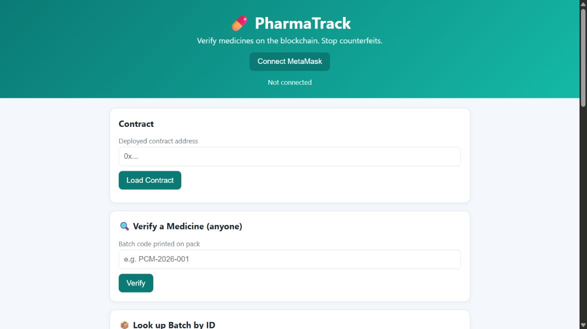

# PharmaTrack - Medicine Authenticity DApp

A decentralized application (Solidity + Ethereum + MetaMask) that lets patients verify whether a medicine batch is genuine, expired or recalled, and shows who has held it along the supply chain.

> **Student:** Sia Sachin Nadkarni  |  **Reg. No.:** 230905522  |  **Assignment:** Blockchain Technology - Assignment 2

---

## 1. Problem addressed

Counterfeit and expired medicines are a serious public-health problem. A patient holding a strip of tablets has no reliable way to check where it came from or whether the batch was recalled. Paper records and centralised databases can be forged or edited.

**PharmaTrack** records medicine batches on the blockchain, where entries cannot be silently altered:

| Role | What they can do |
|------|------------------|
| **Regulator** (contract deployer) | Authorise / revoke manufacturers, recall a batch |
| **Manufacturer** (authorised by regulator) | Register a new medicine batch |
| **Current holder** (manufacturer, distributor, pharmacy) | Transfer custody of a batch to the next party |
| **Anyone / patient** | Verify a batch by the code printed on the pack, view its details and custody trail |

Batch status is computed on-chain: **Genuine**, **Expired** (past expiry date), **Recalled**, or **Not Found** (code was never registered, so likely counterfeit).

## 2. Repository structure

```
contracts/PharmaTrack.sol      Solidity smart contract
frontend/index.html            User interface
frontend/style.css             Styling
frontend/app.js                MetaMask + ethers.js v6 logic
test/test.js                   Automated tests (solc + Ganache + ethers)
test/test-results.md           Generated results (after running tests)
screenshots/                   Evidence screenshots (add yours here)
package.json
```

## 3. Smart contract overview

- **Constructor:** sets the deployer as `regulator`.
- **Variables:** `regulator`, `totalBatches`, `Batch` struct, mappings for manufacturers, batches, used batch codes and custody trail.
- **Functions:** `authoriseManufacturer`, `revokeManufacturer`, `registerBatch`, `transferCustody`, `recallBatch`, `getBatch`, `getCustodyTrail`, `verifyByCode`, `statusOf`.
- **Validation (`require`):** non-empty name and batch code, quantity > 0, expiry in the future, unique batch code, non-zero recipient, no self-transfer, no transfer of recalled or expired batches.
- **Access control:** `onlyRegulator`, `onlyManufacturer`, and a current-holder check for transfers.
- **Events:** emitted for every state change.

## 4. How to run

### 4.1 Compile and deploy in Remix IDE

1. Open <https://remix.ethereum.org> and create `PharmaTrack.sol`; paste the contract from `contracts/`.
2. **Solidity Compiler** tab: choose compiler `0.8.20` or newer and click **Compile**. 📸 *screenshot: compilation*
3. **Deploy & Run** tab, choose the environment:
   - **Option A - Sepolia test network:** Environment = *Injected Provider - MetaMask*, MetaMask on **Sepolia** (get test ETH from a Sepolia faucet).
   - **Option B - Ganache:** start Ganache, import one of its accounts into MetaMask, add network RPC `http://127.0.0.1:7545` (chain ID `1337`, or the ID Ganache shows), Environment = *Injected Provider - MetaMask*.
4. Click **Deploy** and confirm in MetaMask. 📸 *screenshot: deployment*
5. Copy the deployed address into the table in section 5.

### 4.2 Run the frontend

```bash
cd frontend
python3 -m http.server 8000      # or: npx serve .
```

Open <http://localhost:8000>.

### 4.3 Connect MetaMask and interact

1. Click **Connect MetaMask**, approve the connection. 📸 *screenshot: wallet connection*
2. Make sure MetaMask is on the same network you deployed to.
3. Paste the contract address and click **Load Contract**. The page shows the regulator, total batches and your role.
4. As the **regulator** account: enter a manufacturer address and click **Authorise**.
5. Switch MetaMask to the **manufacturer** account, reload, load the contract, and **Register Batch** (e.g. `Paracetamol 500mg`, code `PCM-001`, a future expiry date, quantity `10000`). 📸 *screenshot: successful transaction*
6. Use **Verify a Medicine** with `PCM-001`, and **Look up Batch by ID** `1` to display blockchain data. 📸 *screenshot: data shown in UI*
7. Try an action your account is not allowed to do (e.g. register a batch from a non-manufacturer account). 📸 *screenshot: failed transaction*

## 5. Deployment details

| Item | Value |
|------|-------|
| Network | _Sepolia / Ganache (fill in)_ |
| Contract address | _0x... (fill in)_ |
| Deployer (regulator) | _0x... (fill in)_ |
| Deployment tx hash | _0x... (fill in)_ |

Deployment has not been recorded in this repository yet. Replace these fields after compiling and deploying through Remix. The current interface capture shows the local page before wallet connection; it is not deployment or blockchain-data evidence.

> No private keys or seed phrases are stored in this repository.

## 6. Test cases

Run the automated suite against an in-process Ganache chain. It compiles the Solidity source with solc-js, deploys the contract, and writes the observed results to `test/test-results.md`:

```bash
npm install
npm test
```

The observed-result cells below are intentionally blank until `npm test` has completed successfully. Keep the generated `test/test-results.md` with the submission as test evidence.

| ID | Type | Test case | Expected result | Observed result |
|----|------|-----------|-----------------|-----------------|
| V1 | Valid | Deploy contract | `regulator()` equals deployer | |
| V2 | Valid | Regulator authorises manufacturer | `isManufacturer(addr)` = true | |
| V3 | Valid | Manufacturer registers batch `PCM-001` | Batch #1 stored, event `BatchRegistered` | |
| V4 | Valid | Verify `PCM-001` | Status = Genuine, id 1 | |
| V5 | Valid | Transfer custody manufacturer → distributor → pharmacy | Custody trail has 3 addresses | |
| V6 | Valid | Regulator recalls a batch | Status = Recalled | |
| I1 | Invalid | Register with empty medicine name | Reverts: `Medicine name required` | |
| I2 | Invalid | Register with quantity 0 | Reverts: `Quantity must be > 0` | |
| I3 | Invalid | Register with past expiry date | Reverts: `Expiry must be in the future` | |
| I4 | Invalid | Register duplicate batch code | Reverts: `Batch code already registered` | |
| I5 | Invalid | Authorise zero address | Reverts: `Invalid address` | |
| I6 | Invalid | Transfer custody to the zero address | Reverts: `Invalid recipient` | |
| I7 | Invalid | Query batch ID 99 (does not exist) | Reverts: `Batch does not exist` | |
| I8 | Invalid | Verify unknown code `FAKE-123` | Status = Not Found | |
| I9 | Invalid | Transfer custody to yourself | Reverts: `Cannot transfer to yourself` | |
| I10 | Invalid | Transfer a batch without holding it | Reverts: `Only current holder can transfer` | |
| I11 | Invalid | Transfer a recalled batch | Reverts: `Batch is recalled` | |
| I12 | Invalid | Advance Ganache time past expiry | Status = Expired | |
| I13 | Invalid | Transfer an expired batch | Reverts: `Batch has expired` | |
| U1 | Unauthorised | Non-manufacturer registers a batch | Reverts: `Caller is not an authorised manufacturer` | |
| U2 | Unauthorised | Random account calls `authoriseManufacturer` | Reverts: `Only regulator allowed` | |
| U3 | Unauthorised | Manufacturer calls `recallBatch` | Reverts: `Only regulator allowed` | |
| U4 | Unauthorised | Random account calls `revokeManufacturer` | Reverts: `Only regulator allowed` | |
| U5 | Unauthorised | Non-holder transfers custody | Reverts: `Only current holder can transfer` | |
| U6 | Unauthorised | Revoked manufacturer registers a batch | Reverts: `Caller is not an authorised manufacturer` | |

## 7. Screenshots

Save genuine images captured from Remix, MetaMask, and the running interface in `screenshots/` before submission. Do not add fabricated or illustrative evidence.

| Evidence | File |
|----------|------|
| Smart contract compilation | `screenshots/01-compile.png` (capture after compiling in Remix) |
| Smart contract deployment | `screenshots/02-deploy.png` (capture after deployment) |
| MetaMask wallet connection | `screenshots/03-connect.png` (capture after connecting) |
| Successful transaction | `screenshots/04-success-tx.png` (capture a confirmed transaction) |
| Failed transaction | `screenshots/05-failed-tx.png` (capture a rejected/reverted transaction) |
| Blockchain data shown in UI | `screenshots/06-ui-data.png` (capture batch verification/details) |
| Local interface before wallet connection | [`screenshots/07-interface-live.png`](screenshots/07-interface-live.png) |

The local interface capture below documents the actual page, with no wallet connected and no blockchain data loaded.



## 8. Notes

- Frontend uses **ethers.js v6** loaded from a CDN, so an internet connection is needed to open the page.
- Time-based checks (expiry) use `block.timestamp`.
- Educational project; not audited for production use.
